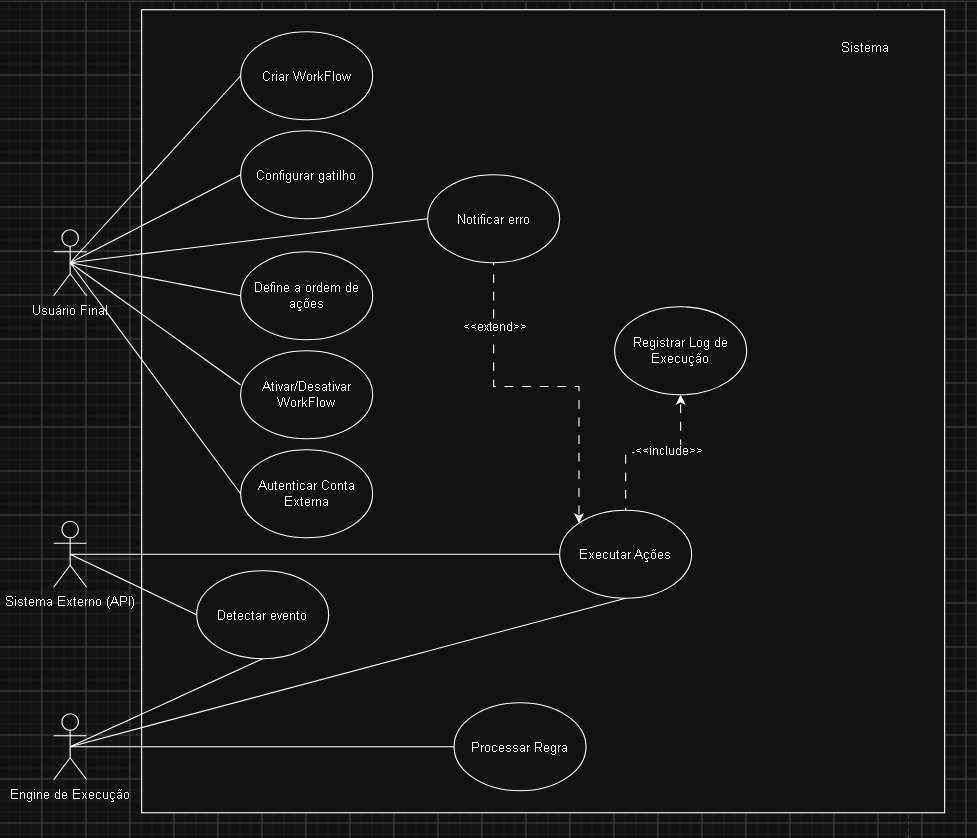
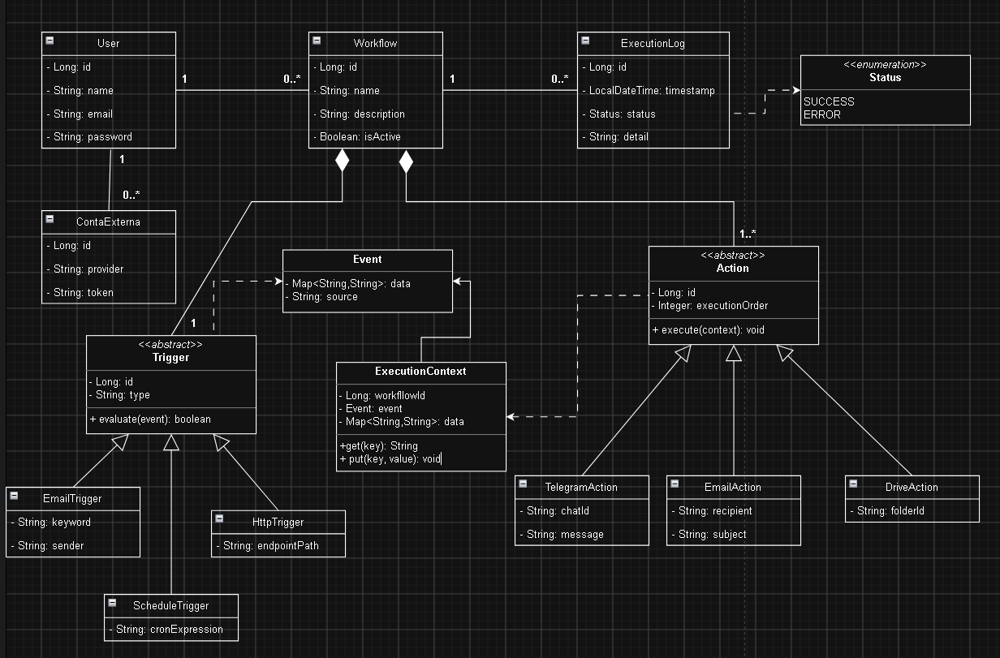

# Workflow Engine

Motor de **workflows** em Java: um gatilho (HTTP ou agendado) dispara uma sequência de ações, e cada execução gera logs. Tem uma **API REST** (com Swagger) e um **dashboard web** para gerenciar tudo pelo navegador. Projeto de portfólio.

## Tecnologias

- Java 21, Spring Boot 3.3.4, Maven
- Spring Data JPA, PostgreSQL, Flyway (migrações em `src/main/resources/db`)
- Spring Security com JWT (jjwt)
- Swagger / springdoc-openapi, Validation, Actuator, Lombok
- Dashboard em HTML + JavaScript (Tailwind CSS e Font Awesome via CDN)
- Docker e Docker Compose

## Telas

Com a aplicação rodando, existem duas formas de usar:

**1. Dashboard (interface visual)**: http://localhost:8080

- Tela de login e de **Criar conta** (a senha precisa ter pelo menos 6 caracteres). Botão **Sair** no canto inferior esquerdo.
- Cards com total de workflows, ativos, taxa de sucesso e execuções das últimas 24h.
- Lista de workflows com busca por nome e filtros por tipo de gatilho (HTTP ou Schedule) e por ativo/inativo.
- **Novo Workflow**: nome, gatilho, intervalo (no caso de Schedule), descrição e os passos (ações) com parâmetros em JSON.
- Para cada workflow: ver detalhes, editar, **executar** e excluir.
- **Monitor de Execuções**: tabela de logs (atualiza sozinha a cada 5 segundos) e, ao clicar no olho, a linha do tempo de cada passo.

**2. Swagger (documentação da API)**: http://localhost:8080/swagger-ui/index.html

Serve para testar os endpoints diretamente (veja "Autenticação").

## Modelagem

Antes de programar, o sistema foi modelado com dois diagramas UML.

**Casos de uso**



**Diagrama de classes**



> Os diagramas são o **projeto original** do sistema. Algumas peças planejadas (como gatilho por e-mail, ações de Telegram, e-mail e Google Drive, e contas externas) não estão implementadas. A implementação atual está descrita nas seções de telas, endpoints e tipos de ação.

## Como foi feito

Projeto desenvolvido com apoio do **Claude Code** (assistente de programação da Anthropic), com a modelagem, as decisões de projeto e os testes conduzidos por mim.

## Como rodar (Docker Compose)

Requisito: Docker Desktop aberto.

```
docker compose up --build
```

Depois, abra o dashboard em http://localhost:8080 ou o Swagger em http://localhost:8080/swagger-ui/index.html.

O `docker-compose.yml` já traz uma senha de banco e uma chave JWT **somente de desenvolvimento local**. Para trocá-las, crie um arquivo `.env` na raiz (ele não vai para o Git):

```
DB_PASSWORD=sua-senha
JWT_SECRET=chave-em-base64-com-pelo-menos-32-bytes
```

Para gerar uma chave JWT no PowerShell:

```
$b = New-Object byte[] 32; (New-Object System.Security.Cryptography.RNGCryptoServiceProvider).GetBytes($b); [Convert]::ToBase64String($b)
```

O banco fica exposto apenas em `127.0.0.1:5433` (porta 5433 do seu computador).

## Como rodar sem Docker

Precisa de um PostgreSQL local com o banco `workflow_engine` e destas variáveis de ambiente definidas antes de iniciar:

- `JWT_SECRET` (Base64, pelo menos 32 bytes). Não há valor padrão: sem ela a aplicação não sobe.
- `SPRING_DATASOURCE_URL` (por exemplo `jdbc:postgresql://localhost:5432/workflow_engine`)
- `SPRING_DATASOURCE_USERNAME`
- `SPRING_DATASOURCE_PASSWORD`

Depois: `./mvnw spring-boot:run` (no Windows: `.\mvnw spring-boot:run`).

## Autenticação

No **dashboard**, crie uma conta em "Criar conta" e entre com usuário e senha. O token JWT fica guardado no navegador e é enviado automaticamente. Se a sessão expirar, a tela de login aparece de novo.

No **Swagger**:

1. `POST /api/auth/register` com `{"username": "...", "password": "..."}` cria a conta.
2. `POST /api/auth/login` com o mesmo corpo devolve `{"token": "...", "username": "..."}`.
3. Clique em **Authorize** e cole o token (formato Bearer).
4. Os demais endpoints exigem o token. São públicos: o dashboard (`/`), `/api/auth/**`, Swagger, `/actuator/health` e `/actuator/info`.

## Endpoints principais

**Workflows**
- `GET /api/workflows` e `POST /api/workflows`
- `GET`, `PUT` e `DELETE /api/workflows/{id}`
- `POST /api/workflows/{id}/execute`
- `POST /api/workflows/{id}/duplicate`
- `PATCH /api/workflows/{id}/active`

**Logs**
- `GET` e `DELETE /api/logs`
- `GET` e `DELETE /api/logs/{id}`
- `GET /api/logs/{id}/details`

**Dashboard**
- `GET /api/stats`

Exemplo de corpo para criar um workflow:

```
{
  "name": "Meu workflow",
  "description": "Exemplo",
  "triggerType": "HTTP",
  "active": true,
  "intervalMinutes": 0,
  "actions": [
    {
      "actionType": "LOG",
      "sequenceOrder": 1,
      "parameters": { "message": "Olá!" },
      "maxRetries": 0
    }
  ]
}
```

Tipos de ação da API: LOG, DATABASE, FILE, HTTP, DECISION, NOTIFICATION e WINDOWS_NOTIFICATION. O dashboard oferece LOG, NOTIFICATION, HTTP, DATABASE, DECISION e FILE.

## Demonstração online (Render, plano gratuito)

- Dashboard: https://workflow-engine-h3g5.onrender.com
- Swagger: https://workflow-engine-h3g5.onrender.com/swagger-ui/index.html

Avisos:

- O plano gratuito "dorme" após 15 minutos sem uso: a **primeira abertura leva cerca de 1 a 2 minutos**.
- O banco gratuito do Render expira e precisa ser recriado (as tabelas são recriadas pelo Flyway). Dados de teste podem sumir.
- Os agendamentos (scheduler) não rodam enquanto o serviço está dormindo.

## Limitações conhecidas

- O cadastro (`/api/auth/register`) é aberto: qualquer pessoa pode criar uma conta.
- `DELETE /api/logs` apaga os logs de **todos** os usuários.
- A ação **DATABASE** executa SQL. Ela fica desligada no Render (`WORKFLOW_DATABASE_ACTION_ENABLED=false`).
- A ação **FILE** é restrita a uma pasta própria (bloqueia `../` e caminhos absolutos), mas não limita o tamanho nem a quantidade de arquivos. No Render gratuito os arquivos somem ao reiniciar.
- O dashboard carrega Tailwind e Font Awesome de CDNs, então precisa de internet para ficar com o visual completo.
- É um projeto de portfólio: **não use dados reais**.